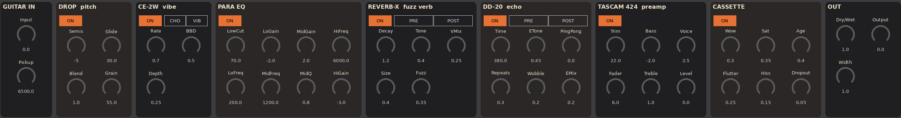
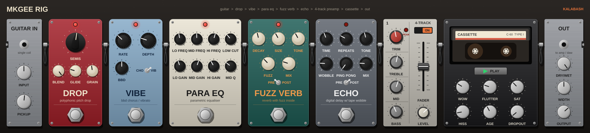

# MKGEE RIG — Max for Live audio effect

A Mk.gee-style guitar chain for Ableton Live. Each pedal in his rig is its own stage, with its own controls and an on/off switch:

```
GUITAR IN → DROP → CE-2W → PARA EQ → [REVERB-X] [DD-20] → TASCAM 424 → [REVERB-X] [DD-20] → CASSETTE → OUT
                                       (PRE)       (PRE)                 (POST)      (POST)
```



## Install
Drag `device/MKGEE RIG.amxd` onto an audio track (Live 11/12 with Max for Live). Put it on the guitar DI track with no amp sim before it: the 424 stage *is* the amp.

## Stages
| Stage | Modelled on | Controls |
|---|---|---|
| GUITAR IN | single-coil neck pickup, tone rolled back | Input, Pickup (tone roll-off) |
| DROP | DigiTech Drop (−5 semis = baritone low B) | On, Semis (−24…+12), Blend, Glide (pitch dives), Grain |
| CE-2W | Boss CE-2W, CE-1 vibrato mode for tape-style wobble | On, CHO/VIB, Rate, Depth, BBD (wet darkness) |
| PARA EQ | Empress ParaEq | On, Lo freq/gain, Mid freq/gain/Q, Hi freq/gain, Low cut |
| REVERB-X | Rainger FX Reverb-X (fuzz into the reverb) | On, PRE/POST 424, Decay, Size, Tone, Fuzz, Mix |
| DD-20 | Boss DD-20 | On, PRE/POST 424, Time (glides like tape), Repeats (>100% self-oscillates), Tone, Wobble, PingPong, Mix |
| TASCAM 424 | Portastudio 424 MkI channel: Trim → op-amp → EQ → Fader → op-amp | On, Trim (gain 1), Fader (gain 2), Bass (100 Hz), Treble (10 kHz), Voice (900 Hz mid push), Level |
| CASSETTE | worn cassette transport | On, Wow, Flutter, Sat, Hiss, Age (HF loss + head bump), Dropout |
| OUT | — | Dry/Wet, Width, Output |

The defaults are a starting point for the sound: Drop −5, CE-1 vibrato with slow rate and low depth, fuzzy reverb *before* the 424 so the reverb gets distorted, Trim at 22 dB and the Fader at +6.

**Dialling the 424 stage:** keep Trim moderate and raise the Fader until chords start to break up. Higher Trim also makes it darker and gooier. Level compensates so the stage sits near unity.

## VST3 / AU plugin (Mac)



The same DSP as the Max for Live device, as a VST3 and Audio Unit with a hardware-style UI. The chain runs left to right: guitar in, the five pedals, the 4-track channel strip with its fader, the cassette deck, then out. Click a footswitch to bypass that pedal. Double-click any knob to reset it. Drag the window corner to resize.

**Install:** download the DMG from [Releases](../../releases) or from the latest *Build Mac plugin + installer* Actions run. Open it and run `Install MKGEE RIG.pkg`. The plugin isn't notarised, so the first time you'll need right-click the pkg > Open.

**Build it yourself:** `cmake -S plugin -B build -DCMAKE_BUILD_TYPE=Release && cmake --build build`, then `installer/build_installer.sh build/MkgeeRig_artefacts/Release 1.0.0`.

**DSP source of truth:** `tools/dsp.py` generates both `gen/mkgee_rig.genexpr` (Ableton) and `plugin/Source/MkgeeDSP.h` (plugin, via `python3 tools/gen_cpp.py`), so the two always match.

## Repo layout
- `device/MKGEE RIG.amxd`: the device
- `device/mkgee_rig.maxpat`: the same patch as a plain Max patcher
- `gen/mkgee_rig.genexpr`: the DSP (one gen~ codebox, generated)
- `tools/dsp.py`: DSP source and parameter table. Edit here, then run `python3 tools/build.py`
- `tools/sim.py`: offline test harness that runs the DSP in Python (`python3 tools/sim.py default|post|extreme|bypass`)
